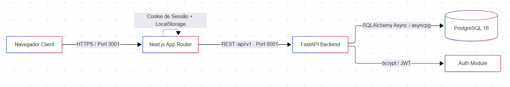

# Painel da Ouvidoria ARPE — Documentação Técnica

**Versão:** 1.0  
**Última atualização:** 2026-10-08  
**Responsável:** Gustavo Lino  
**Público:** Desenvolvedores, tech leads, auditoria técnica  

---

## 1. Visão Geral

O **Painel da Ouvidoria ARPE** é uma aplicação web para consolidação, tratamento e análise analítica de manifestações recebidas pela Agência de Regulação de Pernambuco (ARPE). O sistema realiza a ingestão de planilhas Excel, normaliza e otimiza os dados em um modelo de dados dimensional (Star Schema) e disponibiliza um dashboard analítico interativo para acompanhamento de KPIs, tendências temporais e auditoria detalhada de dados em tabela paginada.

---

## 2. Arquitetura

### 2.1 Diagrama de Componentes


### 2.2 Fluxo de Dados

1. **Ingestão:** O administrador faz o upload da planilha Excel (`.xlsx`, `.xls`, `.xlsm`) via interface `/uploads`.
2. **Processamento:** O backend (`POST /api/v1/uploads`) utiliza `pandas` / `openpyxl` / `xlrd` para validar e normalizar as dimensões (`dim_data`, `dim_assunto`, `dim_origem`, `dim_status`) e registrar o registro na `fato_manifestacoes` associado ao `upload_id`.
3. **Persistência:** Registro gravado no banco de dados analítico PostgreSQL.
4. **Consulta Analítica:** A UI solicita métricas e agregados (`/dashboard/kpis`, `/dashboard/evolution`, `/dashboard/call-center-comparison`). As queries em SQL analítico consolidam volumes e métricas na camada do banco.
5. **Renderização:** O frontend renderiza cartões de KPIs e gráficos responsivos utilizando `Recharts` e `Lucide React`.

### 2.3 Decisões Arquiteturais (ADRs)

| Decisão | Motivo | Trade-off |
| --- | --- | --- |
| **Star Schema (`dim_*` e `fato_*`)** | Alta performance em consultas analíticas e agregações dimensionais sem travar o banco. | Ingestão com processo ETL interno levemente mais complexo do que um schema OLTP 3FN. |
| **Consultas SQL diretas/otimizadas com `text()**` | Evita overhead de ORM em consultas pesadas de agregados e agrupamentos analíticos. | Exige atenção manual ao tipar os schemas do Pydantic na resposta. |
| **Database Migrations via Alembic** | Garante controle estrito e versionado sobre evoluções da estrutura do schema. | Exige execução do passo `alembic upgrade head` no pipeline ou container. |
| **JWT curto + Cookie espelho no Next.js** | Garante requisições stateless na API e suporte nativo ao gerenciamento de rotas protegidas na renderização do Next.js. | Sincronização de estado entre cliente local e cabeçalho HTTP. |

## 3. Stack Tecnológica

### 3.1 Frontend

* **Framework:** Next.js `16.2.9` (App Router)
* **Biblioteca Base:** React `19.2.4`, React DOM `19.2.4`
* **Estilização:** Tailwind CSS `^4` (via `@tailwindcss/postcss`)
* **Gráficos:** Recharts `^3.9.2`
* **Ícones:** Lucide React `^1.24.0`
* **Linguagem:** TypeScript `^5`

### 3.2 Backend

* **Linguagem:** Python `3.12`
* **Framework Web:** FastAPI (executado via `uvicorn[standard]`)
* **ORM & Async DB:** SQLAlchemy (com suporte `asyncio`) + `asyncpg`
* **Processamento de Planilhas:** `pandas`, `openpyxl`, `xlrd`
* **Validação de Schemas:** Pydantic / `pydantic-settings`
* **Migrations:** Alembic + `psycopg` (v3 `3.2.3`)

### 3.3 Autenticação & Segurança

* **Hash de Senha:** `bcrypt`
* **Tokens:** JWT assinado com `python-jose[cryptography]`

### 3.4 Infraestrutura e Banco de Dados

* **Banco de Dados Relacional:** PostgreSQL `16`
* **Orquestração Local:** Docker & Docker Compose (`postgres:16`, container `api` FastAPI, container `frontend` Next.js)

## 4. Modelo de Dados (Star Schema)

* `dim_data`: Tabela calendário com chave substituta (`sk_data`), ano, mês, nome do mês e `ano_mes`.
* `dim_assunto`: Cadastro dimensional de assunto/subassunto contendo flags específicas de negócio (`flag_dificuldade_call_center`, `flag_desconsiderar_regra_arpe`).
* `dim_origem`: Mapeamento das origens de atendimento e órgãos regulados.
* `dim_status`: Modalidades, situações e tipos de registro.
* `uploads_planilhas`: Metadados e controle de histórico de uploads de planilhas Excel ingeridas.
* `fato_manifestacoes`: Tabela fato contendo as métricas e foreign keys para todas as dimensões e para `upload_id`.
* `users`: Cadastro de usuários contendo identificador único UUID (`user_id`), nome, e-mail, `hashed_password`, `role` (`admin`, `servidor`) e flag de status `is_active`.

## 5. API — Endpoints Principais

| Método | Rota | Descrição | Permissão |
| --- | --- | --- | --- |
| `POST` | `/api/v1/auth/login` | Autenticação do usuário e emissão do Bearer JWT | Público |
| `GET` | `/api/v1/users/me` | Retorna o perfil do usuário atualmente autenticado | Autenticado |
| `GET` | `/api/v1/filters` | Retorna as opções disponíveis para os seletores de filtro | Autenticado |
| `GET` | `/api/v1/manifestacoes` | Listagem paginada de manifestações com filtros dinâmicos | Autenticado |
| `GET` | `/api/v1/dashboard/kpis` | Retorna KPIs consolidados para os cartões analíticos | Autenticado |
| `GET` | `/api/v1/dashboard/evolution` | Retorna dados para o gráfico de evolução temporal | Autenticado |
| `GET` | `/api/v1/dashboard/call-center-comparison` | Dados comparativos do destaque do Call Center | Autenticado |
| `GET` | `/api/v1/uploads` | Lista o histórico de planilhas processadas | Admin |
| `POST` | `/api/v1/uploads` | Realiza o upload e processamento ETL de arquivo `.xlsx` | Admin |
| `DELETE` | `/api/v1/uploads/{upload_id}` | Remove um upload e desfaz as inserções associadas | Admin |
| `GET` / `POST` | `/api/v1/users` | Gestão e cadastro de usuários do sistema | Admin |
| `GET` / `PATCH` / `DELETE` | `/api/v1/users/{user_id}` | Consulta, atualização ou remoção de usuário | Admin |

---

## 6. Autenticação e Autorização

* **Login e Hash:** Autenticação via formulário. A validação de credenciais utiliza `bcrypt`.
* **Sessão Stateless:** Tokens JWT são assinados no backend e transmitidos pelo cabeçalho `Authorization: Bearer <token>`.
* **Roteamento no Frontend:** O token é persistido e espelhado em cookie de sessão para validação no proxy/middleware do Next.js.
* **Autorização (RBAC):** Proteção backend rigorosa através do dependency injector `AdminUser` no FastAPI. A interface oculta rotas de edição para perfil `servidor`, porém a imposição real é feita nas rotas da API.

---

## 7. Como Rodar Localmente (Docker)

1. **Clonar o repositório:**
```bash
git clone [https://github.com/GustavoLino728/dashboard-ouv-arpe.git](https://github.com/GustavoLino728/dashboard-ouv-arpe.git)
cd dashboard-ouv-arpe

```


2. **Configurar Variáveis de Ambiente:**
Crie o arquivo `./backend/.env` baseado na estrutura necessária:
```env
POSTGRES_USER=postgres
POSTGRES_PASSWORD=postgres
POSTGRES_DB=ouvidoria_arpe
DATABASE_URL=postgresql+asyncpg://postgres:postgres@db:5432/ouvidoria_arpe
SECRET_KEY=sua_chave_secreta_jwt

```


3. **Subir os Containers:**
```bash
docker compose up -d --build

```


*Serviços mapeados:*
* **Frontend:** `http://localhost:3001`
* **API (FastAPI):** `http://localhost:8001` (Docs em `http://localhost:8001/docs`)
* **Banco de Dados (PostgreSQL):** `localhost:5434`


4. **Executar Migrations do Banco:**
```bash
docker compose exec api alembic upgrade head

```


---

## 8. Implantação e Deploy

* **Banco de Dados:** PostgreSQL hospedado via Supabase ou instância gerenciada.
* **Backend / API:** Serviço de container/Python (ex: Render, Railway ou VPS) apontando para a porta `8000`.
* **Frontend:** Plataforma Vercel, Netlify ou Render conectada à branch principal do repositório.
* **Variáveis de Ambiente:** Devem ser inseridas diretamente no painel de configurações do provedor cloud (nunca versionadas em arquivos `.env`).

---

## 9. Testes e Cobertura

* **Backend:** Testes unitários para validação de regras de ETL e schemas do Pydantic.
* **Manual / QA:** Testes de carga de arquivos de planilhas em formatos heterogêneos (`.xlsx`, `.xls`, `.xlsm`).
* **Planos Futuros:** Implementação de suítes de teste de integração no backend (`pytest-asyncio`) e testes E2E no frontend com Playwright.

---

## 10. Limitações Conhecidas e Próximos Passos

* **Taxa de Requisições:** Ausência temporária de middleware para *rate limiting* nos endpoints de autenticação.
* **Exportação:** Botão de exportação direta em formato CSV/Excel a partir da consulta de manifestações em desenvolvimento.
* **Notificações:** Feedback de processamento de planilhas pesadas por fila assíncrona (Celery/Redis) previsto para versões futuras.

```